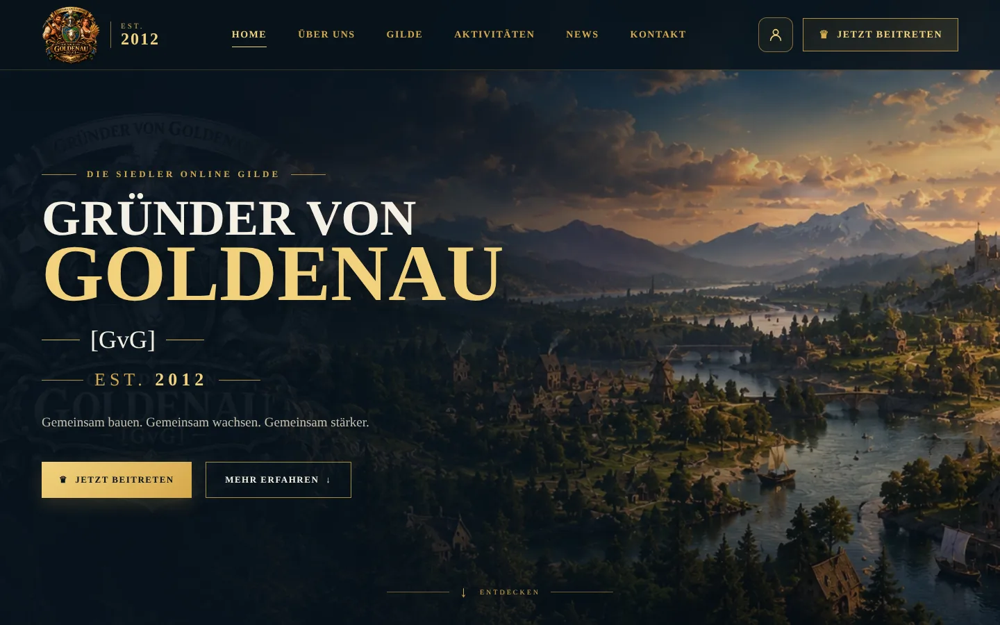
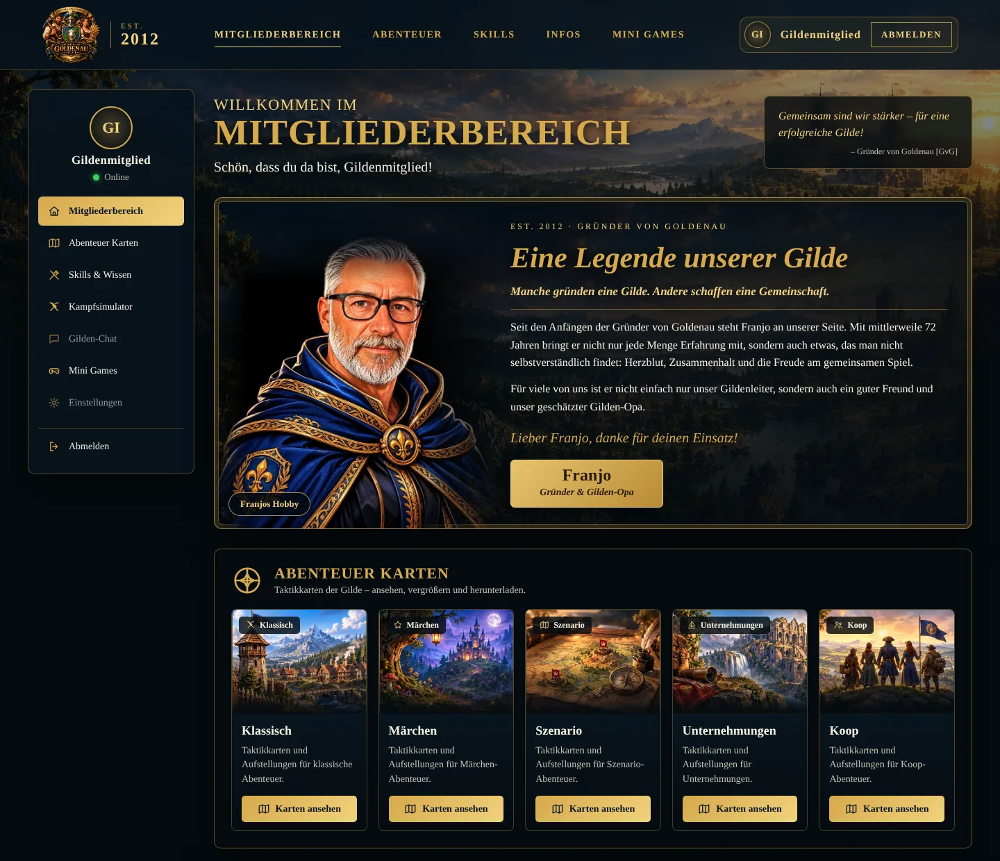

<div align="center">

# GRÜNDER VON GOLDENAU [GvG]

### Gildenwebsite · Die Siedler Online · Est. 2012

Fan-Website unserer Siedler-Online-Gilde mit Mitgliederbereich, Abenteuer-Karten, Generäle- und Entdecker-Übersicht, Kampfsimulator und Mini Games.


**[▶ Zur Live-Seite](https://marcel-schmitz-dev.github.io/siedler-gilde/)**



</div>

---

## Über das Projekt

Die Website der Gilde **„Gründer von Goldenau“ [GvG]** (gegründet **2012**) besteht aus zwei Teilen:

- **Öffentliche Seite** im dunklen Design mit Gold-Akzenten: Hero, Über uns, News, Mitglieder, Beitreten-Bereich, Footer, Impressum, Datenschutz.
- **Mitgliederbereich**, der nach der Anmeldung (Supabase) sichtbar wird.

Das Projekt entsteht im Rahmen meiner Weiterbildung zum Webentwickler (Frontend). Ziel: sauberes HTML, strukturiertes SCSS und typisiertes TypeScript, **ohne Framework und ohne Bundler**.

## Funktionen

### Öffentlicher Bereich

- Hero mit Gründungsjahr, Über uns, Aktivitäten, News und Mitgliederübersicht
- Registrieren- und Anmelden-Fenster im Seitendesign
- Responsive Layout mit mobilem Menü

### Mitgliederbereich (nach dem Login)



- **Ehrung für Franjo, den Gründer:** Porträt mit Hover-Wechsel zu seinem Hobby (Motorrad)
- **Abenteuer Karten** in fünf Kategorien (Klassisch, Märchen, Szenario, Unternehmungen, Koop): Grid, Großansicht und Download
- **Generäle und Entdecker:** alle Einträge mit Werten, Besonderheiten, Suche, Sortierung und Detailfenster (Garnison, Fähigkeiten-Vorschlag, Herkunft)
- **Kampfsimulator NEONFRONT:** direkt im Mitgliederbereich nutzbar (eingebettet per iframe von GitHub Pages)
- **Mini Games:** Grid mit eigenen Spielen, jeweils mit „Live Test“ und „GitHub“
- **Unterseiten ohne Framework:** kleiner Hash-Router (`#generaele`, `#entdecker`, `#kampfsimulator`, `#minigames`, `#karten-…`)

### Rechtliches

- Impressum, Datenschutzerklärung (DE), Privacy Policy (EN) und Haftungsausschluss, passend zum Design. Die Texte enthalten gelb markierte Platzhalter, die vor dem Veröffentlichen ersetzt werden müssen (siehe [Rechtliches](#rechtliches-1)).

## Tech-Stack

| Bereich    | Technik                                                                          |
| :--------- | :------------------------------------------------------------------------------- |
| Markup     | HTML5, semantisch                                                                |
| Styling    | SCSS (7-1-ähnliche Struktur), kompiliert nach `css/main.css`                     |
| Logik      | TypeScript (ES-Module im Browser), kompiliert nach `js/`                         |
| Login      | Supabase Auth, Datenbank mit Row Level Security                                  |
| Hosting    | GitHub Pages (kompiliertes `css/` und `js/` liegen im Repository)                |
| Werkzeuge  | `sass`, `tsc`, VS Code Live Server                                               |

Es gibt keinen Bundler. Die Supabase-Bibliothek wird als Browser-Bundle lokal unter `js/vendor/supabase.js` ausgeliefert, damit beim Seitenaufruf keine Anfrage an einen fremden CDN-Server geht.

## Schnellstart

Voraussetzung: [Node.js](https://nodejs.org) (aktuelle LTS-Version).

```bash
git clone https://github.com/marcel-schmitz-dev/siedler-gilde.git
cd siedler-gilde
npm install

npm run vendor   # Supabase-Bundle nach js/vendor/ kopieren (einmalig und nach Updates)
npm run sass     # SCSS -> css/main.css
npm run ts       # TypeScript -> js/
```

Dann `index.html` mit **Live Server** (Port 5501) öffnen. Ein Doppelklick auf die Datei funktioniert nicht, weil die Seite ES-Module nutzt.

Während der Entwicklung:

```bash
npm run sass:watch
npm run ts:watch
```

> Nach Änderungen an SCSS oder TypeScript immer neu kompilieren und die kompilierten Dateien mit committen, sonst liefert GitHub Pages den alten Stand aus. Online hilft danach **Strg + F5** gegen den Browser-Cache.

## Supabase einrichten

1. Projekt auf [supabase.com](https://supabase.com) anlegen.
2. In `ts/config.ts` die **Project URL** und den **anon/public key** eintragen (Project Settings → API). Der anon-Key darf im Frontend stehen. Der **service_role-Key darf niemals** ins Repository.
3. Im **SQL Editor** den Inhalt von `supabase-setup.sql` ausführen. Das legt die Tabelle `profiles` (Spielername) mit Row Level Security und einen Trigger an, der beim Registrieren automatisch ein Profil erstellt.
4. Unter **Authentication → URL Configuration** die Site URL und Redirect URLs eintragen:
    - `http://127.0.0.1:5501` und `http://localhost:5501` (lokal)
    - `https://marcel-schmitz-dev.github.io/siedler-gilde/` (online)
5. **Confirm email** ist aktuell ausgeschaltet, weil der eingebaute Mailversand von Supabase stark begrenzt ist. Dadurch kann sich jeder mit beliebiger E-Mail registrieren. Für den Dauerbetrieb einen eigenen SMTP-Dienst einrichten (z. B. Brevo oder Resend) und die Bestätigung wieder einschalten.

## Veröffentlichen mit GitHub Pages

*Settings → Pages → Branch `main`, Ordner `/ (root)`.* Die Seite ist danach unter `https://marcel-schmitz-dev.github.io/siedler-gilde/` erreichbar. Alle Pfade im Projekt sind relativ, deshalb funktioniert sie auch im Unterordner.

## Inhalte pflegen

| Was                       | Wo                                                                                          |
| :------------------------ | :------------------------------------------------------------------------------------------ |
| Abenteuer-Karten          | Bild in `assets/img_karten/` ablegen, Eintrag in `ts/data/adventure-maps.ts`                |
| Kategorie-Bilder (Reiter) | `assets/img/abenteuer/` (`klassisch`, `maerchen`, `szenario`, `unternehmungen`, `koop`)     |
| Mini Games                | Eintrag in `ts/data/minigames.ts`, Vorschaubild in `assets/img/minigames/`                  |
| Kampfsimulator            | Link und Beschreibung in `ts/data/tools.ts`                                                 |
| Generäle und Entdecker    | `ts/data/specialists.ts` (optional pro General: Garnison-Bild, Fähigkeiten, Herkunft)       |
| Ehrung für Franjo         | Text in `index.html` (Abschnitt `#member-tribute`), Bilder in `assets/img/franjo/`          |
| Rechtstexte               | `impressum.html`, `datenschutz.html`, `privacy.html`, `haftungsausschluss.html`             |

## Projektstruktur

```
index.html              Öffentliche Seite + Mitgliederbereich + Login-Fenster
impressum.html          Rechtliche Seiten
datenschutz.html
privacy.html
haftungsausschluss.html
supabase-setup.sql      Tabelle profiles, Row Level Security, Trigger
scripts/copy-vendor.js  kopiert das Supabase-Bundle nach js/vendor/

scss/
  abstracts/            Variablen, Mixins
  base/                 Reset
  layout/               Header
  components/           hero, about, news, members, join, footer, auth,
                        member, member-views, tribute
  pages/                legal, legal-extra
  main.scss             Einstiegspunkt

ts/
  config.ts             Supabase-URL und anon key
  supabase.ts           Client (nutzt js/vendor/supabase.js)
  auth.ts               Registrieren, Anmelden, Abmelden, UI-Zustand
  member.ts             Name, Initialen, letzter Login, Menü
  views.ts              Hash-Router für die Unterseiten
  specialists.ts        Generäle und Entdecker (Suche, Sortierung, Details)
  maps.ts               Abenteuer-Karten mit Großansicht und Download
  minigames.ts          Mini-Games-Grid
  simulator.ts          Kampfsimulator (iframe)
  tribute.ts            Hover-Wechsel der Franjo-Ehrung
  dom.ts                Hilfsfunktionen und Dialog
  data/                 Daten: specialists, adventure-maps, minigames, tools
  main.ts               Einstiegspunkt

css/ js/                kompilierte Dateien (werden mit committet)
assets/                 Bilder (Logo, Hintergründe, Karten, Skills, Franjo …)
docs/                   Screenshots für diese README
```

## Datenschutz und Sicherheit

- Es werden **keine Cookies zu Werbe- oder Analysezwecken** und keine Tracking-Dienste verwendet.
- Gespeichert werden nur Daten für den Login: Spielername, E-Mail, Passwort (als Hash) und technische Sitzungsdaten, verarbeitet über **Supabase**. Hosting über **GitHub Pages**.
- Der Mitgliederbereich wird im Browser ein- und ausgeblendet. Das ist **kein echter Zugriffsschutz**. Inhalte, die wirklich geschützt sein müssen, gehören hinter Row Level Security in die Datenbank.
- Von TSOwiki werden Icons direkt geladen (`TSOWIKI_BASE` in `ts/data/specialists.ts`). Für einen vollständig fremdserverfreien Betrieb die Icons lokal ablegen und den Wert anpassen.

## Rechtliches

Dieses Projekt ist ein **inoffizielles Fan-Projekt** ohne Verbindung zu Ubisoft oder CipSoft. „Die Siedler Online“ ist eine Marke von Ubisoft; Betrieb, Entwicklung und Infrastruktur werden von CipSoft verantwortet. Alle Spieldaten, Icons und Grafiken gehören den jeweiligen Rechteinhabern.

**Vor dem Veröffentlichen:** In `impressum.html`, `datenschutz.html` und `privacy.html` sind gelbe Platzhalter `[…]` (Anschrift, Supabase-Region, Aufsichtsbehörde, Auftragsverarbeitungsvertrag u. a.) durch echte Angaben zu ersetzen. Die Texte sind eine Arbeitsgrundlage und ersetzen keine Rechtsberatung.

## Datenquellen

- Generäle und Entdecker: [tsowiki.eu](https://tsowiki.eu) (inoffizielles Fan-Wiki), Beschreibungen gekürzt und umformuliert
- Spieldaten und Grafiken: *Die Siedler Online*

## Roadmap

- [ ] „Passwort vergessen“ (`resetPasswordForEmail` plus Seite zum Setzen des neuen Passworts)
- [ ] Eigener SMTP-Dienst, danach „Confirm email“ wieder einschalten
- [ ] Mitgliederliste aus der Tabelle `profiles` laden
- [ ] Echt geschützte Bereiche per Row Level Security
- [ ] Fähigkeiten und Herkunft für alle Generäle ergänzen, Icons lokal ablegen

## Commit-Konvention

Kleine, übersichtliche Commits im Stil von Conventional Commits, zum Beispiel `feat(member): …`, `fix(about): …`, `chore: …`.

## Lizenz

Noch nicht festgelegt. Bis dahin gilt: Quellcode zur Ansicht, alle Rechte vorbehalten. Spielbezogene Inhalte bleiben im Besitz der jeweiligen Rechteinhaber.

---

<div align="center">

**Gemeinsam. Stark. Für Goldenau.**

© 2026 Marcel Schmitz · Gründer von Goldenau [GvG] · Est. 2012

</div>
